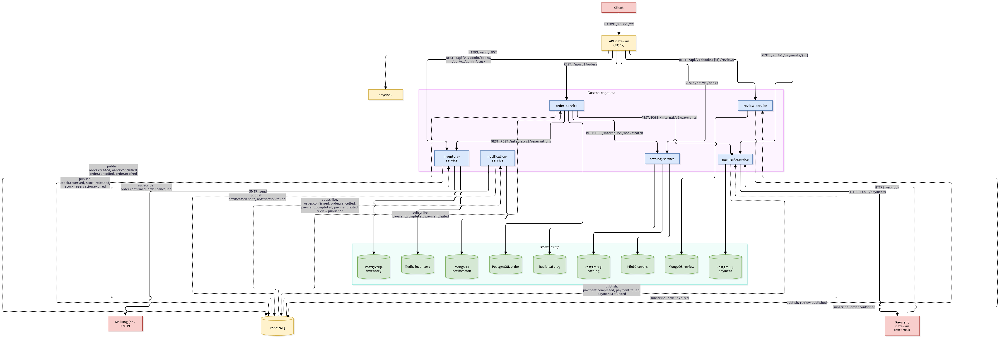
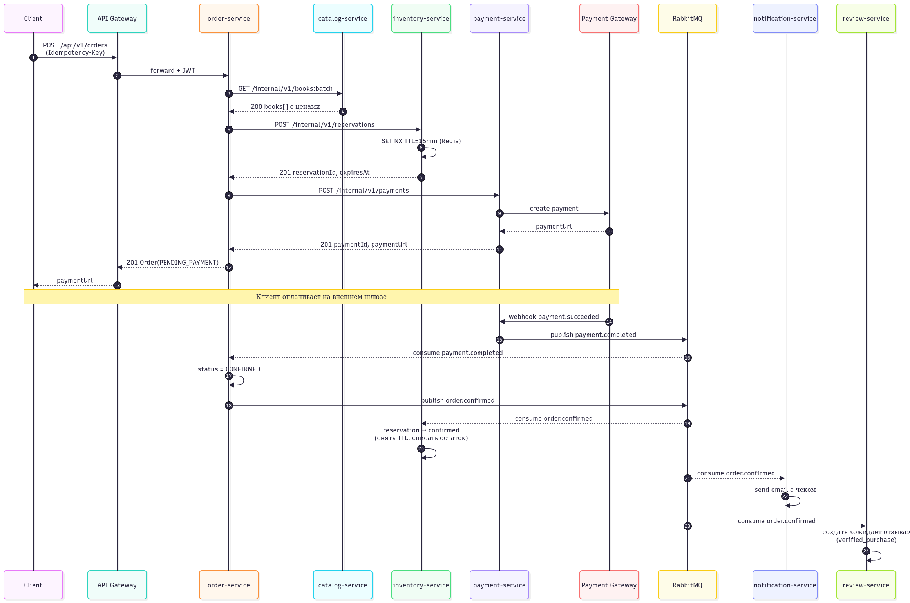
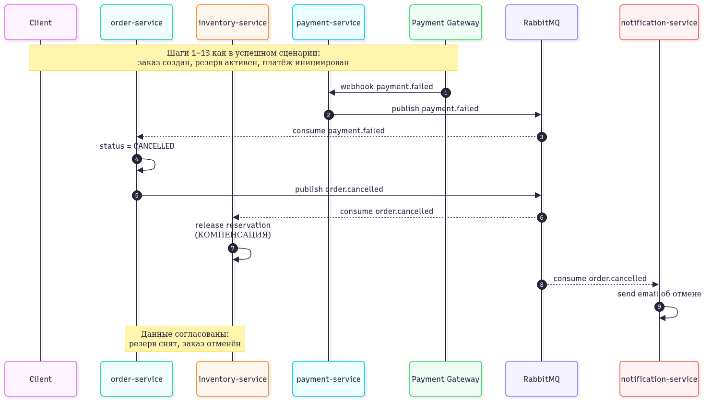

# BookStore – микросервисный онлайн-магазин книг

## Содержание

1. [Анализ предметной области](#1-анализ-предметной-области)
2. [Карточки сервисов](#2-карточки-сервисов)
3. [Выбор ПО](#3-выбор-по)
4. [Схемы взаимодействий](#4-схемы-взаимодействий)
5. [Контракты API](#5-контракты-api) *(Шаг 5)*

---

## 1. Анализ предметной области

### 1.1. Описание системы

**BookStore** – онлайн-магазин книг для розничных покупателей. Система позволяет искать книги по каталогу, оформлять заказы с онлайн-оплатой, получать электронные чеки и уведомления, а также оставлять отзывы о приобретённых книгах. Помимо покупателей, системой пользуются менеджеры каталога (управление книгами и ценами) и модераторы отзывов. Система интегрируется с внешним платёжным шлюзом и сервисом email-рассылки.

### 1.2. Акторы

#### Пользователи системы

| Актор | Описание |
|-------|----------|
| **Гость** | Неавторизованный посетитель. Просматривает каталог, ищет книги, читает отзывы. Не может оформить заказ. |
| **Клиент (покупатель)** | Авторизованный пользователь. Ищет и покупает книги, оставляет отзывы, смотрит историю заказов. |
| **Менеджер каталога** | Добавляет и редактирует книги, авторов, жанры, цены. Снимает книги с продажи. |
| **Модератор отзывов** | Просматривает новые отзывы, публикует или отклоняет их. |

#### Внешние системы

| Система | Назначение |
|---------|-----------|
| **Платёжный шлюз** | Приём оплаты и возвратов (ЮKassa / аналог). Взаимодействие через `payment-service`. |
| **Email-провайдер** | Отправка писем клиенту (SendGrid / SMTP). Взаимодействие через `notification-service`. |

Инфраструктура (не акторы): **Keycloak** – аутентификация и выдача JWT; **API Gateway (Nginx)** – единая точка входа.

### 1.3. Пользовательские сценарии

Формат: «Как <роль>, я хочу <действие>, чтобы <цель>».

1. **Как гость**, я хочу искать книги по названию, автору или жанру, чтобы найти интересующую меня книгу.
2. **Как гость**, я хочу открыть карточку книги с описанием, ценой и рейтингом, чтобы принять решение о покупке.
3. **Как клиент**, я хочу добавить книги в корзину и оформить заказ, чтобы купить их одним платежом.
4. **Как клиент**, я хочу оплатить заказ онлайн, чтобы получить подтверждение и электронный чек.
5. **Как клиент**, я хочу получить письмо с деталями заказа, чтобы иметь подтверждение покупки.
6. **Как клиент**, я хочу оставить отзыв о купленной книге, чтобы поделиться мнением с другими покупателями.
7. **Как менеджер каталога**, я хочу добавлять и редактировать книги и цены, чтобы каталог оставался актуальным.
8. **Как модератор отзывов**, я хочу одобрять или отклонять новые отзывы, чтобы фильтровать спам и неприемлемый контент.

### 1.4. Доменные события

Упрощённый Event Storming – события сгруппированы вокруг будущих контекстов.

#### Каталог

- `BookAddedToCatalog` – книга добавлена в каталог
- `BookPriceChanged` – изменилась цена книги
- `BookDiscontinued` – книга снята с продажи

#### Склад

- `StockReserved` – N экземпляров удержаны под заказ на 15 минут
- `StockReservationExpired` – удержание истекло без оплаты
- `StockReleased` – удержание снято (компенсация при отмене)
- `StockDepleted` – остаток исчерпан

#### Заказы

- `OrderCreated` – заказ оформлен, ожидает оплаты
- `OrderConfirmed` – оплата прошла, заказ подтверждён
- `OrderCancelled` – заказ отменён (клиентом или при сбое оплаты)
- `OrderExpired` – заказ не оплачен в течение TTL и закрыт

#### Платежи

- `PaymentInitiated` – платёж создан в шлюзе
- `PaymentCompleted` – оплата успешно завершена
- `PaymentFailed` – оплата отклонена
- `RefundIssued` – возврат средств выполнен

#### Отзывы

- `ReviewSubmitted` – отзыв отправлен клиентом
- `ReviewPublished` – отзыв одобрен модератором
- `ReviewRejected` – отзыв отклонён

#### Уведомления

- `NotificationSent` – письмо отправлено
- `NotificationFailed` – ошибка отправки (с повтором)

### 1.5. Ограниченные контексты и глоссарии

Шесть бизнес-контекстов. Один контекст = один сервис (стартовая гипотеза).

#### 1. Catalog Context

**Глоссарий:**

- **Книга** – товарная позиция с уникальным ISBN, названием, автором, описанием.
- **Автор** – лицо, написавшее книгу. Может быть автором многих книг.
- **Жанр** – тематическая категория (фантастика, детектив, …).
- **Цена** – текущая стоимость продажи одной копии.

#### 2. Inventory Context

**Глоссарий:**

- **Складская позиция** – количество экземпляров конкретной книги на складе.
- **Резерв** – временное удержание N экземпляров под конкретный заказ на 15 минут.
- **Движение** – операция прихода или расхода.
- **Дефицит** – ситуация, когда заказано больше, чем есть в наличии.

#### 3. Order Context

**Глоссарий:**

- **Корзина** – временный набор книг, ещё не оформленный как заказ.
- **Заказ** – оформленное намерение купить с уникальным номером, статусом и составом.
- **Позиция заказа** – снимок книги на момент оформления: `bookId`, название, цена, количество.
- **Статус заказа** – `PENDING_PAYMENT` → `CONFIRMED` | `CANCELLED` | `EXPIRED`.
- **Сага покупки** – последовательность шагов (резерв → оплата → подтверждение) с компенсациями при сбое.

#### 4. Payment Context

**Глоссарий:**

- **Платёж** – запрос на списание денег, привязанный к заказу.
- **Возврат** – компенсирующая операция при отмене оплаченного заказа.
- **Статус платежа** – `INITIATED` | `COMPLETED` | `FAILED` | `REFUNDED`.

#### 5. Review Context

**Глоссарий:**

- **Отзыв** – текстовое сообщение клиента о купленной книге.
- **Оценка** – числовая оценка 1–5 в составе отзыва.
- **Рейтинг книги** – агрегат (среднее и количество) по опубликованным отзывам.
- **Статус модерации** – `PENDING` | `PUBLISHED` | `REJECTED`.

#### 6. Notification Context

**Глоссарий:**

- **Уведомление** – единица отправки (одно письмо одному адресату).
- **Шаблон** – параметризованный текст письма (чек, приглашение к отзыву).
- **Журнал отправок** – история попыток с их статусами.
- **Канал** – email сейчас; SMS/push – возможное расширение.

### 1.6. Иллюстрация: почему контексты важны

Одно и то же слово в разных контекстах означает **разное**:

| Термин | В Catalog | В Order | В Payment | В Notification |
|--------|-----------|---------|-----------|----------------|
| **Книга** | полная сущность (ISBN, автор, описание, цена) | снимок названия и цены на момент покупки | – | название в шаблоне письма |
| **Заказ** | – | сущность с составом и статусом | `orderId` + сумма | данные для подстановки |
| **Цена** | текущая цена продажи | зафиксированная при оформлении | – | – |

---

## 2. Карточки сервисов

### 2.1. Сводная таблица

| Сервис | Ответственность | Владеет данными | Ключевые зависимости |
|--------|-----------------|-----------------|----------------------|
| `catalog-service` | книги, авторы, жанры, цены, поиск | Book, Author, Genre, Price | Redis (кэш), PostgreSQL |
| `inventory-service` | остатки на складе, резервы с TTL | StockItem, Reservation | PostgreSQL, Redis (TTL-блокировки), подписан на `order.*` |
| `order-service` | корзина, заказ, оркестрация саги | Cart, Order, OrderItem | catalog (sync), inventory (sync), payment (sync), подписан на `payment.*` |
| `payment-service` | платежи, возвраты, интеграция со шлюзом | Payment, Refund | внешний платёжный шлюз, публикует `payment.*` |
| `review-service` | отзывы, модерация, рейтинг книг | Review, Rating | MongoDB, подписан на `order.confirmed` |
| `notification-service` | email-уведомления клиенту | NotificationLog | MongoDB, SMTP/SendGrid, подписан на `order.*`, `payment.*`, `review.published` |

### 2.2. Карточки сервисов

#### catalog-service

| Поле | Значение |
|------|----------|
| **Название** | `catalog-service` |
| **Ответственность** | Хранит и предоставляет данные о книгах, авторах, жанрах и ценах. Обеспечивает полнотекстовый поиск и фильтрацию каталога. |
| **Владеет данными** | `Book`, `Author`, `Genre`, `Price` |
| **Предоставляет (sync)** | `GET /api/v1/books` – список с пагинацией и фильтрами `GET /api/v1/books/{id}` – карточка книги `GET /internal/v1/books/{id}` – внутренний (для order-service) `GET /internal/v1/books:batch` – пакетная выдача (для корзины) `POST /api/v1/admin/books` – добавление (роль менеджера) `PUT /api/v1/admin/books/{id}` – редактирование |
| **Публикует события** | `BookAddedToCatalog`, `BookPriceChanged`, `BookDiscontinued` |
| **Зависит от (sync)** | – |
| **Подписан на** | – |
| **НФТ** | Высокая нагрузка на чтение (100:1 к записи), задержка чтения < 100 мс, доступность 99.9%, кэш в Redis. Критичность: высокая (без каталога магазин не работает). |
| **Обоснование границы** | 1) Отдельная бизнес-возможность «управление каталогом». 2) Резко разные НФТ: чтение в десятки раз чаще остальных операций → отдельное масштабирование и кэш. 3) Меняется независимо от заказов и оплаты. |

#### inventory-service

| Поле | Значение |
|------|----------|
| **Название** | `inventory-service` |
| **Ответственность** | Учёт физических экземпляров книг на складе и временных резервов под заказы с TTL 15 минут. |
| **Владеет данными** | `StockItem`, `Reservation` |
| **Предоставляет (sync)** | `POST /internal/v1/reservations` – создать резерв (Idempotency-Key) `DELETE /internal/v1/reservations/{orderId}` – снять резерв `GET /internal/v1/stock/{bookId}` – остаток по книге `POST /api/v1/admin/stock` – приход/расход (роль менеджера) |
| **Публикует события** | `StockReserved`, `StockReservationExpired`, `StockReleased`, `StockDepleted` |
| **Зависит от (sync)** | – |
| **Подписан на** | `order.cancelled`, `order.expired` – снять резерв (компенсация) |
| **НФТ** | Средняя нагрузка, критичность высокая (нужен ACID для атомарного списания остатка), задержка < 200 мс. Использует Redis для TTL-блокировок с автопродлением. |
| **Обоснование границы** | 1) Своя бизнес-возможность «управление складом». 2) Логика конкуренции за остаток и TTL-резервов сильно отличается от всего остального. 3) Может работать автономно, если order-service временно недоступен (резервы обрабатываются по входящим командам из очереди). |

#### order-service

| Поле | Значение |
|------|----------|
| **Название** | `order-service` |
| **Ответственность** | Управление корзиной и заказами, оркестрация саги покупки (резерв → оплата → подтверждение) с компенсациями при сбоях. |
| **Владеет данными** | `Cart`, `Order`, `OrderItem` |
| **Предоставляет (sync)** | `POST /api/v1/cart/items` – добавить в корзину `GET /api/v1/cart` – корзина пользователя `POST /api/v1/orders` – оформить заказ (Idempotency-Key) `GET /api/v1/orders/{id}` – статус заказа `GET /api/v1/orders` – история заказов (пагинация) |
| **Публикует события** | `OrderCreated`, `OrderConfirmed`, `OrderCancelled`, `OrderExpired` |
| **Зависит от (sync)** | `catalog-service` – получить актуальные цены и названия `inventory-service` – создать/снять резерв `payment-service` – инициировать платёж |
| **Подписан на** | `payment.completed`, `payment.failed`, `payment.refunded` |
| **НФТ** | Задержка оформления < 1 с, критичность высокая. Пиковая нагрузка (распродажи), требуется идемпотентность для повторов. |
| **Обоснование границы** | 1) Ядро бизнеса с самой сложной логикой (сага, компенсации). 2) Единственный сервис, который владеет «Заказом» как сущностью – для остальных это лишь ID и сумма. 3) Оркестратор саги, поэтому должен быть отдельным от участников (payment, inventory) – иначе теряется автономность. |

#### payment-service

| Поле | Значение |
|------|----------|
| **Название** | `payment-service` |
| **Ответственность** | Создание платежей, приём статусов от внешнего шлюза, выполнение возвратов. |
| **Владеет данными** | `Payment`, `Refund` |
| **Предоставляет (sync)** | `POST /internal/v1/payments` – создать платёж (Idempotency-Key) `POST /internal/v1/refunds` – инициализировать возврат `GET /internal/v1/payments/{id}` – статус |
| **Публикует события** | `PaymentInitiated`, `PaymentCompleted`, `PaymentFailed`, `RefundIssued` |
| **Зависит от (sync)** | Внешний платёжный шлюз (ЮKassa / аналог) |
| **Подписан на** | `order.expired` – если оплата пришла после истечения заказа, инициировать возврат |
| **НФТ** | Критичность максимальная (деньги, аудит), строгая идемпотентность, полное логирование, задержка < 3 с. |
| **Обоснование границы** | 1) Изоляция интеграции с внешним шлюзом (изменения шлюза не должны трогать orders). 2) Отдельные требования: совместимость, аудит, идемпотентность. 3) Отдельный жизненный цикл сущности «Платёж», он не равен «Заказу». |

#### review-service

| Поле | Значение |
|------|----------|
| **Название** | `review-service` |
| **Ответственность** | Приём отзывов клиентов, модерация, публикация и агрегация рейтинга книг. |
| **Владеет данными** | `Review`, `Rating` (агрегат) |
| **Предоставляет (sync)** | `GET /api/v1/books/{bookId}/reviews` – список отзывов (пагинация) `POST /api/v1/books/{bookId}/reviews` – оставить отзыв (Idempotency-Key) `GET /api/v1/books/{bookId}/rating` – средний рейтинг `POST /api/v1/admin/reviews/{id}/moderate` – модерация |
| **Публикует события** | `ReviewSubmitted`, `ReviewPublished`, `ReviewRejected` |
| **Зависит от (sync)** | – (проверку «есть ли подтверждённая покупка» делает локально по флагу, полученному из события) |
| **Подписан на** | `order.confirmed` – создаёт черновик «ожидается отзыв» с флагом `verified_purchase` |
| **НФТ** | Чтение отзывов – очень частое (на странице книги), запись – редкая. Гибкая схема документа (разные поля для книг/авторов/покупателей), поэтому MongoDB. Задержка чтения < 150 мс. |
| **Обоснование границы** | 1) Своя бизнес-возможность «модерация и рейтинг». 2) Документная модель (MongoDB) вместо реляционной, другой тип хранилища. 3) Другая частота изменений: рейтинг пересчитывается на каждое событие, тогда как каталог меняется редко. |

#### notification-service

| Поле | Значение |
|------|----------|
| **Название** | `notification-service` |
| **Ответственность** | Отправка email-уведомлений клиенту по событиям системы: подтверждение заказа, чек, приглашение к отзыву. |
| **Владеет данными** | `NotificationLog`, `Template` |
| **Предоставляет (sync)** | `GET /internal/v1/notifications?orderId=...` – история отправок по заказу (для отладки/поддержки) |
| **Публикует события** | `NotificationSent`, `NotificationFailed` |
| **Зависит от (sync)** | Внешний email-провайдер (SendGrid / аналог провайдера / SMTP) |
| **Подписан на** | `order.confirmed`, `order.cancelled`, `order.expired`, `payment.completed`, `payment.failed`, `review.published` |
| **НФТ** | Не критичен для бизнес-транзакции: сбой отправки не должен ломать покупку. Работает асинхронно, retry с backoff, dead-letter queue для «мёртвых» писем. |
| **Обоснование границы** | 1) Асинхронная природа: клиенту не нужен ответ сразу. 2) Изоляция: интеграция с email-провайдером не должна влиять на заказы. 3) Отдельный тип хранилища (MongoDB) – журнал с разнородными payload. |

### 2.3. Отвергнутые варианты разбиения

#### Вариант А: объединить `order-service` и `payment-service`

**Рассматривали:** один сервис `order-payment` – «всё про заказ и деньги».

**Отказались, потому что:**

1. **Разная критичность и требования.** Платежи требуют аудита, изоляции ключей шлюза. Заказы это обычная бизнес-логика.
2. **Разный жизненный цикл.** «Платёж» не равен «Заказ»: у одного заказа может быть несколько попыток оплаты и возвратов.
3. **Зависимость от внешней системы.** Если интегрировать платёжный шлюз внутрь orders, любое изменение шлюза ломает заказы.

#### Вариант Б: объединить `catalog-service` и `inventory-service`

**Рассматривали:** `product-service` – «книга + остаток на складе» в одной БД.

**Отказались, потому что:**

1. **Разные НФТ.** Каталог читается в 100 раз чаще; склад – редко, но требует ACID-транзакций. Масштабировать их нужно по-разному.
2. **Разные модели изменений.** Цена меняется редко (менеджер), остаток – постоянно.
3. **Разные владельцы данных.** «Цена» и «Остаток» – независимые сущности. В одной БД их изменение всегда блокирует друг друга.

#### Вариант В: сделать `user-service`

**Рассматривали:** собственный сервис пользователей (регистрация, профиль, адреса).

**Отказались, потому что:**

1. **Keycloak уже решает аутентификацию** (OAuth 2.0 / OpenID Connect) – писать свой сервис – дублирование.
2. **Профиль и адреса** – минимум данных, без бизнес-логики.
3. Если в будущем понадобится – вынесем отдельно, но сейчас это не даёт ценности.

---

## 3. Выбор ПО

### 3.1. Таблица выбранных компонентов

| Компонент | Какие сервисы используют | Обоснование выбора |
|-----------|--------------------------|--------------------|
| **PostgreSQL** (отдельный инстанс на сервис) | catalog, inventory, order, payment | Все четыре сервиса оперируют сущностями со **строгой схемой** и **связями**. Требуются **транзакции ACID**: атомарное списание остатка, атомарная смена статуса заказа, аудит платежей. SQL-схема нужна для отчётности и аналитики. |
| **MongoDB** (отдельный инстанс на сервис) | review, notification | **review**: отзывы имеют разную структуру в зависимости от типа (книга / автор / пользователь), а читаются всегда целиком документом – гибкая схема выгоднее фиксированной. **notification**: журнал отправок хранит разные шаблоны писем, строгая схема только мешает. В обоих случаях нет потребности в связях и транзакциях между документами. |
| **Redis** (отдельный инстанс на сервис) | catalog (кэш), inventory (TTL-резервы) | **catalog**: соотношение чтения к записи 100:1 – кэш горячих книг ускоряет отдачу до < 10 мс. **inventory**: резерв – это ключ с TTL 15 минут; Redis даёт встроенный автоэкспайр и атомарные операции, что идеально подходит для блокировки остатка. |
| **RabbitMQ** | Keycloak, inventory, order, catalog, review, payment | Нужны **событийный и командно-очередной** обмен: `order.confirmed` (событие, несколько подписчиков – review, notification), `payment.completed` (событие, оркестратор – order), задачи с retry и DLQ (уведомления). RabbitMQ даёт маршрутизацию через exchanges, гарантию доставки, dead-letter queue «из коробки».|
| **Nginx** | все 6 сервисов (через него идут запросы от клиента), Keycloak (проверка JWT) | Требуется **единая точка входа**: маршрутизация по пути к сервисам, проверка JWT (связка с Keycloak), rate limiting, TLS-терминация. Nginx лёгкий, стабильный, прост в конфигурировании; функционала хватает. |
| **Keycloak** | Gateway + все сервисы (проверка JWT) | Требуется OAuth 2.0 / OpenID Connect «без собственной реализации». Keycloak даёт готовые роли, refresh-токены и интеграцию с Nginx. Собственный user-service запрещён ТЗ. |
| **MinIO** | catalog | Обложки книг – бинарные объекты. Хранить их в PostgreSQL (BYTEA) является антипаттерном, который раздувает БД, ломает бэкапы. |
| **MailHog** | notification (**только dev-окружение**) | Реальная отправка email в учебном проекте небезопасна. MailHog перехватывает SMTP-трафик и показывает письма в веб-интерфейсе – можно проверить шаблоны, не отправляя ничего наружу. В проде заменяется на SendGrid / свой SMTP; абстракция в коде одна – SMTP-клиент. |

### 3.2. Отвергнутые варианты

| Что рассматривали | Почему отказались |
|-------------------|-------------------|
| **MySQL** вместо PostgreSQL для catalog/inventory/order/payment | PostgreSQL лучше работает с JSONB (для гибких атрибутов книги), имеет более мощные типы (range, enum), лучшую поддержку полнотекстового поиска. Для нашего объёма данных разница в производительности несущественна, а возможности PostgreSQL шире. |
| **Kafka** вместо RabbitMQ | Kafka оправдана, когда нужен **поток событий с повторным чтением** и партиционированием под высокую нагрузку (миллионы событий в секунду). У нас нагрузка на порядки ниже, а команды (не только события) с retry и DLQ в RabbitMQ реализуются проще. Kafka требует ZooKeeper/KRaft, тюнинга топиков и партиций – избыточно для учебного проекта. |

---

## 4. Схемы взаимодействий

### 4.1. Архитектурная схема

**Обозначения:**
- Сплошные стрелки – синхронные вызовы (REST / HTTPS)
- Пунктирные – асинхронные события через RabbitMQ

### 4.2. Диаграммы последовательности

#### Успешный сценарий

#### Сбой оплаты

### 4.3. Таблица взаимодействий

#### Синхронные вызовы – клиент через Gateway (public API)

| № | Инициатор → Получатель | Протокол | Эндпоинт | Назначение |
|---|------------------------|----------|----------|------------|
| 1 | client → Gateway → catalog | REST | `GET /api/v1/books` | список книг с фильтрами и пагинацией |
| 2 | client → Gateway → catalog | REST | `GET /api/v1/books/{id}` | карточка книги |
| 3 | client → Gateway → order | REST | `POST /api/v1/cart/items` | добавить в корзину |
| 4 | client → Gateway → order | REST | `GET /api/v1/cart` | получить корзину |
| 5 | client → Gateway → order | REST | `POST /api/v1/orders` | оформить заказ (Idempotency-Key) |
| 6 | client → Gateway → order | REST | `GET /api/v1/orders/{id}` | статус заказа |
| 7 | client → Gateway → order | REST | `GET /api/v1/orders` | история заказов (пагинация) |
| 8 | client → Gateway → payment | REST | `GET /api/v1/payments/{id}` | статус платежа (read-only) |
| 9 | client → Gateway → review | REST | `GET /api/v1/books/{id}/reviews` | список отзывов книги |
| 10 | client → Gateway → review | REST | `POST /api/v1/books/{id}/reviews` | оставить отзыв (Idempotency-Key) |
| 11 | manager → Gateway → catalog | REST | `POST /api/v1/admin/books` | добавить книгу |
| 12 | manager → Gateway → catalog | REST | `PUT /api/v1/admin/books/{id}` | редактировать книгу |
| 13 | manager → Gateway → inventory | REST | `POST /api/v1/admin/stock` | приход/расход остатка |
| 14 | moderator → Gateway → review | REST | `POST /api/v1/admin/reviews/{id}/moderate` | модерация отзыва |
| 15 | Gateway → Keycloak | HTTPS | `GET /realms/.../certs` | проверка JWT (кешируется) |

#### Синхронные вызовы – сервис-к-сервису (internal, напрямую, минуя Gateway)

| № | Инициатор → Получатель | Протокол | Эндпоинт | Назначение |
|---|------------------------|----------|----------|------------|
| 16 | order → catalog | REST | `GET /internal/v1/books:batch` | актуальные цены и названия для корзины |
| 17 | order → inventory | REST | `POST /internal/v1/reservations` | зарезервировать экземпляры (Idempotency-Key) |
| 18 | order → payment | REST | `POST /internal/v1/payments` | создать платёж (Idempotency-Key) |
| 19 | order → inventory | REST | `DELETE /internal/v1/reservations/{orderId}` | снять резерв (компенсация) |
| 20 | order → payment | REST | `POST /internal/v1/refunds` | инициировать возврат (компенсация) |

#### Синхронные вызовы – к внешним системам

| № | Инициатор → Получатель | Протокол | Эндпоинт | Назначение |
|---|------------------------|----------|----------|------------|
| 21 | payment → Payment Gateway | HTTPS | `POST /payments` | создать платёжную сессию, получить `paymentUrl` |
| 22 | Payment Gateway → payment | HTTPS | webhook `payment.succeeded` / `payment.failed` | уведомление о результате оплаты |
| 23 | notification → MailHog (dev) | SMTP | `send` | отправка письма клиенту (в проде – SendGrid/аналог) |

#### Асинхронные – публикация событий (RabbitMQ)

| № | Издатель | Событие | Назначение |
|---|----------|---------|------------|
| 24 | order | `order.created` | заказ создан, ожидает оплаты |
| 25 | order | `order.confirmed` | оплата прошла, заказ подтверждён |
| 26 | order | `order.cancelled` | заказ отменён (в т.ч. при сбое оплаты) |
| 27 | order | `order.expired` | заказ не оплачен за TTL |
| 28 | payment | `payment.completed` | оплата успешно завершена |
| 29 | payment | `payment.failed` | оплата отклонена |
| 30 | payment | `payment.refunded` | возврат выполнен |
| 31 | inventory | `stock.reserved` | резерв создан |
| 32 | inventory | `stock.released` | резерв снят (компенсация) |
| 33 | inventory | `stock.reservation.expired` | TTL резерва истёк |
| 34 | review | `review.published` | отзыв одобрен модератором |
| 35 | notification | `notification.sent` | письмо отправлено |
| 36 | notification | `notification.failed` | ошибка отправки (после retry) |

#### Асинхронные – подписка на события (RabbitMQ)

| № | Подписчик | Событие | Реакция |
|---|-----------|---------|---------|
| 37 | order | `payment.completed` | перевести заказ в `CONFIRMED` |
| 38 | order | `payment.failed` | перевести заказ в `CANCELLED`, запустить компенсацию |
| 39 | order | `payment.refunded` | пометить заказ как полностью возвращённый |
| 40 | payment | `order.expired` | если оплата прошла позже – инициировать возврат |
| 41 | inventory | `order.confirmed` | подтвердить резерв, списать остаток |
| 42 | inventory | `order.cancelled` | снять резерв (компенсация) |
| 43 | inventory | `order.expired` | снять резерв (компенсация) |
| 44 | review | `order.confirmed` | создать запись «ожидает отзыва» с флагом `verified_purchase` |
| 45 | notification | `order.confirmed` | отправить письмо с деталями заказа и чеком |
| 46 | notification | `order.cancelled` | отправить письмо об отмене |
| 47 | notification | `order.expired` | напомнить, что заказ сгорел |
| 48 | notification | `payment.completed` | отправить чек об оплате |
| 49 | notification | `payment.failed` | уведомить об ошибке оплаты |
| 50 | notification | `review.published` | пригласить клиента оставить отзыв |

#### Сага покупки – компенсации при сбоях

| Сбой | Компенсирующее действие |
|------|-------------------------|
| Payment вернул `payment.failed` | order → `CANCELLED`, публикует `order.cancelled` → inventory снимает резерв |
| Клиент не оплатил за 15 минут | TTL резерва истекает → `stock.reservation.expired` → order публикует `order.expired` |
| Оплата пришла после `order.expired` | payment подписан на `order.expired` → инициирует `refund` → `payment.refunded` |
| Дубликат события (retry) | все consumer'ы хранят обработанные `eventId`, повтор игнорируется (идемпотентность) |
| inventory недоступен при компенсации | сообщение остаётся в очереди, retry с backoff, после N попыток → DLQ |

---

## 5. Контракты API

### 5.1. Спецификации API

| Сервис | Спецификация |
|--------|--------------|
| order-service | [order-service.yaml](api/order-service.yaml) |
| catalog-service | [catalog-service.yaml](api/catalog-service.yaml) |
| inventory-service | [inventory-service.yaml](api/inventory-service.yaml) |
| payment-service | [payment-service.yaml](api/payment-service.yaml) |
| review-service | [review-service.yaml](api/review-service.yaml) |
| notification-service | [notification-service.yaml](api/notification-service.yaml) |

### 5.2. Асинхронные события

Спецификация событий: [events.yaml](api/events.yaml) (AsyncAPI 2.6.0).

| Событие | Топик (RabbitMQ) | Издатель | Подписчики | Ссылка на схему в `events.yaml` |
|---------|------------------|----------|------------|---------------------------------|
| `order.created` | `orders` | order-service | – | `#/components/messages/OrderCreated` |
| `order.confirmed` | `orders` | order-service | inventory, review, notification | `#/components/messages/OrderConfirmed` |
| `order.cancelled` | `orders` | order-service | inventory, notification | `#/components/messages/OrderCancelled` |
| `order.expired` | `orders` | order-service | payment, notification | `#/components/messages/OrderExpired` |
| `payment.completed` | `payments` | payment-service | order, notification | `#/components/messages/PaymentCompleted` |
| `payment.failed` | `payments` | payment-service | order, notification | `#/components/messages/PaymentFailed` |
| `payment.refunded` | `payments` | payment-service | order | `#/components/messages/PaymentRefunded` |
| `stock.reserved` | `inventory` | inventory-service | – | `#/components/messages/StockReserved` |
| `stock.released` | `inventory` | inventory-service | – | `#/components/messages/StockReleased` |
| `stock.reservation.expired`| `inventory` | inventory-service | order | `#/components/messages/StockReservationExpired` |
| `review.published` | `reviews` | review-service | notification | `#/components/messages/ReviewPublished` |

