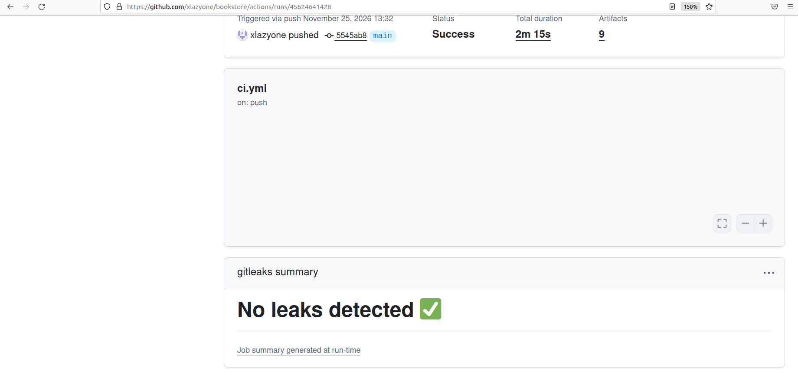
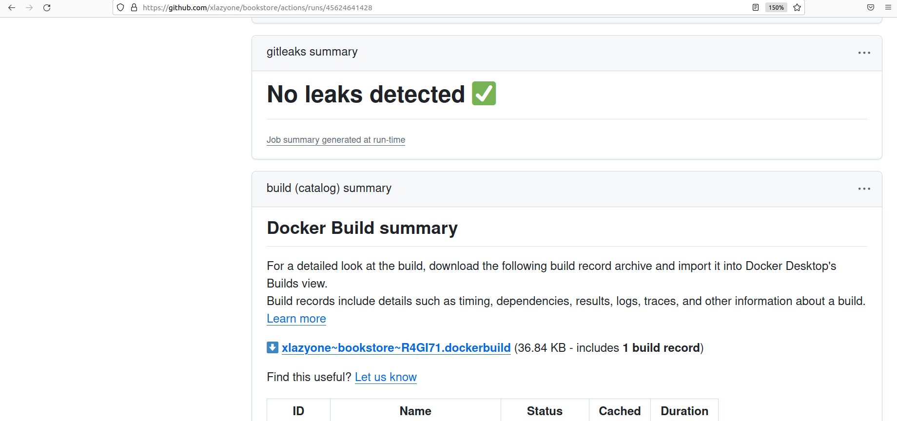
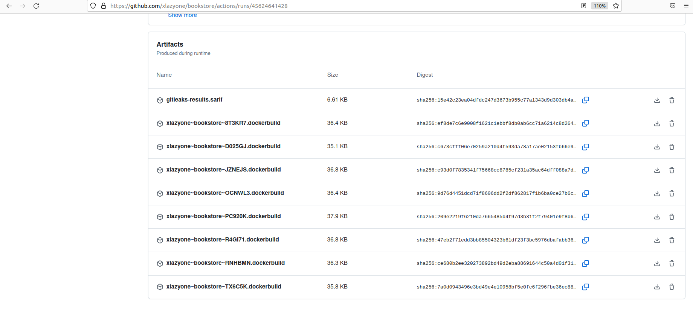
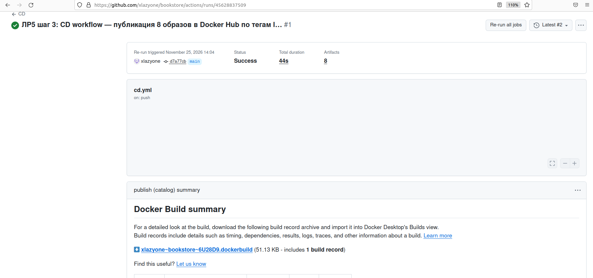
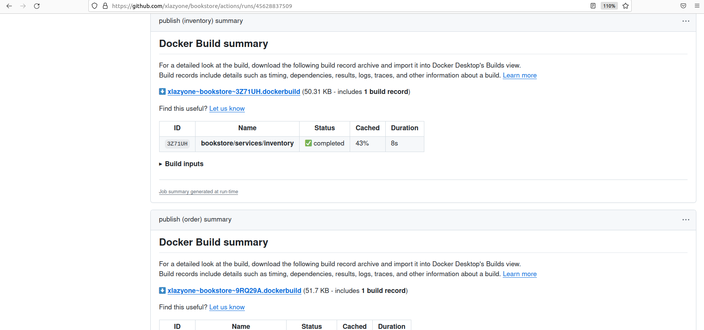
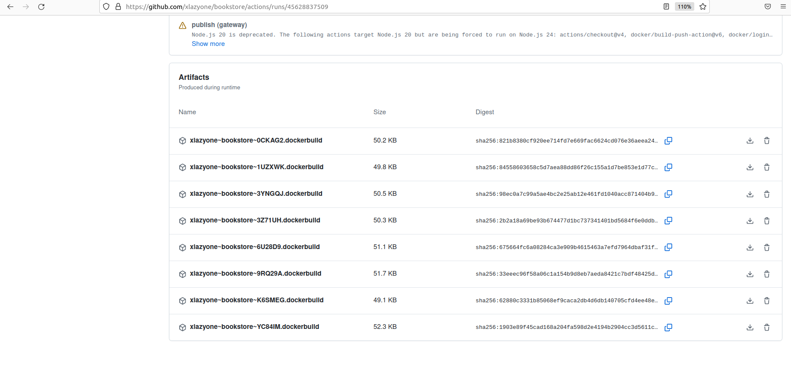
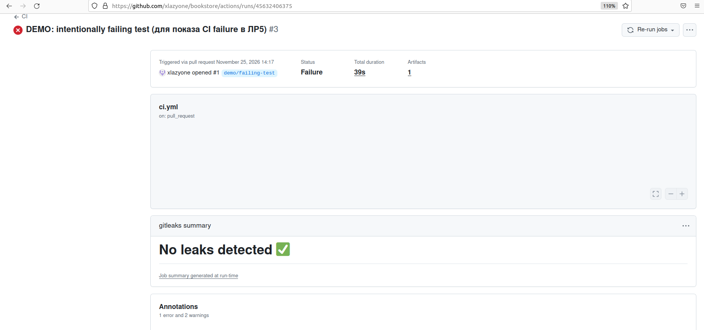
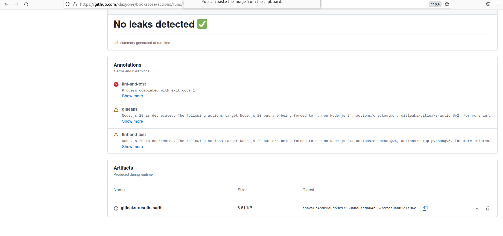
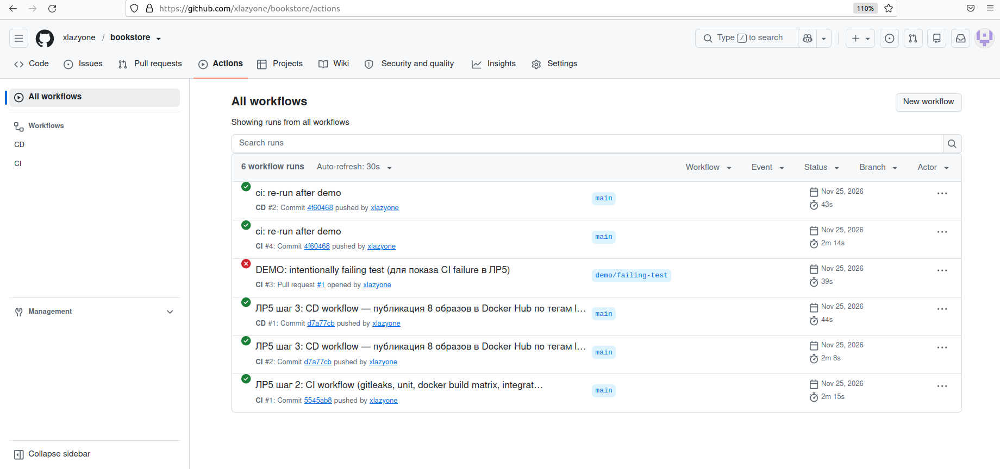
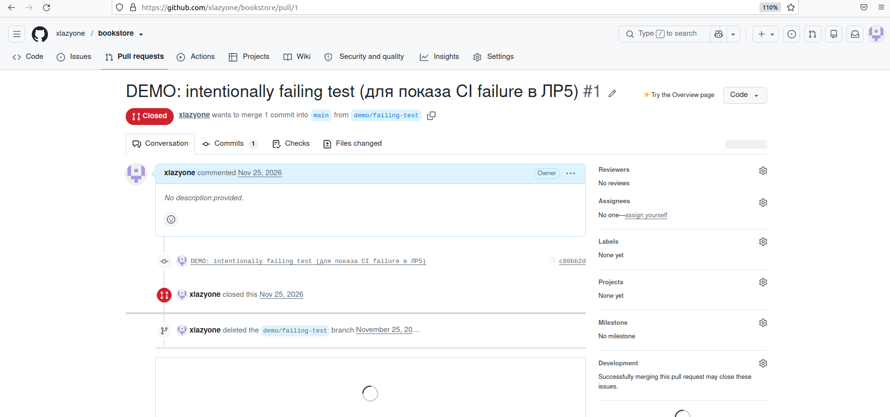

# CI/CD для BookStore (ЛР5)

Документация по настройке непрерывной интеграции и доставки для микросервисной
системы BookStore (ЛР4).

## 1. Выбор платформы

**GitHub Actions.** Обоснование:

- Репозиторий проекта уже размещён на GitHub — интеграция «из коробки», без внешних сервисов.
- Не требуется собственный runner: GitHub предоставляет hosted runners (Ubuntu, 2 vCPU, 7 ГБ RAM, 14 ГБ диска).
- **`GITHUB_TOKEN`** автоматически доступен в workflow — не нужно вручную хранить токен для служебных операций (gitleaks читает код, build-push-action кэширует слои в GHA).
- Секреты (Docker Hub) хранятся в **Settings → Secrets and variables → Actions**, не попадают в код (требование ЛР5, п.5).
- Бесплатно для публичных репозиториев.

Альтернативы (GitLab CI, Jenkins, TeamCity) отклонены: первая — не тот хостинг,
остальные — требуют собственного сервера и избыточны для учебного проекта.

## 2. Структура пайплайнов

Два workflow-файла:

| Файл | Триггер | Назначение |
|------|---------|------------|
| `.github/workflows/ci.yml` | `push` в `main`, `pull_request` в `main`, ручной `workflow_dispatch` | Сканирование секретов, unit-тесты, сборка 8 Docker-образов, интеграционные тесты + smoke |
| `.github/workflows/cd.yml` | `push` в `main`, тег `v*.*.*`, ручной запуск | Публикация 8 Docker-образов в Docker Hub |

Разделение обосновано: **на PR не публикуем** (нельзя пушить в реестр из непроверенного кода), **на main — публикуем** (`latest` + `sha-<short>`).

## 3. CI (`ci.yml`) — этапы

Схема зависимостей: `secrets-scan → lint-and-test → docker-build (×8) → integration-tests`.

### 3.1. `secrets-scan` (gitleaks)

- Инструмент: [`gitleaks/gitleaks-action@v2`](https://github.com/gitleaks/gitleaks-action).
- Сканирует **всю историю** коммитов (`fetch-depth: 0`) на утечки токенов, паролей, ключей.
- Исключения в `.gitleaks.toml`:
  - `.env.example` (dev-значения типа `dev-secret-change-me`, `guest:guest`),
  - `tests/`, `docs/`, `README.md`, `.github/`,
  - регексы `dev-secret-change-me`, `guest:guest`.
- Результаты: SARIF-артефакт `gitleaks-results.sarif`.

### 3.2. `lint-and-test`

- Python 3.11, `actions/setup-python@v5` с `cache: pip`.
- Установка: `pip install -r shared/requirements.txt -r shared/requirements-dev.txt`.
- Запуск: `pytest tests/unit -v` → **18 тестов**.
- Покрытие: `shared/` (problem, idempotency, broker-хелперы), бизнес-логика `inventory` (резервы, TTL), `payment` (HMAC-подпись вебхука), шаблоны `notification`.

### 3.3. `docker-build` (матрица, 8 сервисов)

| Сервис | Путь |
|--------|------|
| catalog | `services/catalog` |
| inventory | `services/inventory` |
| order | `services/order` |
| payment | `services/payment` |
| review | `services/review` |
| notification | `services/notification` |
| gateway | `gateway` |
| mock-payment-gateway | `mocks/payment-gateway` |

- `docker/build-push-action@v6` с `push: false` — только валидация Dockerfile.
- `fail-fast: false` — если падает один сервис, остальные 7 всё равно собираются (видно все проблемы сразу).
- Кэш: `cache-from/cache-to: type=gha,scope=<service>` — повторные прогоны быстрее в 2–3 раза.
- На каждый сервис — артефакт `xlazyone~bookstore~<random>.dockerbuild` (BuildKit-отчёт).

### 3.4. `integration-tests`

- Поднимает **весь стек** через `docker compose up -d --build`.
- Ждёт готовности Gateway (`GET /health`, до 3 минут, шаг 2 сек).
- Запускает:
  - `pytest tests/integration -v -m integration` — **6 тестов** (happy path, failure path, идемпотентность, health, поиск, Problem Details),
  - `./scripts/smoke_test.sh` — end-to-end: gateway → order → catalog → inventory → payment → mock-psp → RabbitMQ → notification.
- При падении: `docker compose logs --tail=200` выгружаются в лог job'а (`if: failure()`).
- Всегда: `docker compose down -v` (`if: always()`) — чистит раннер.

### 3.5. Защита от «зависших» пайплайнов

- `timeout-minutes` на каждом job: 5/10/15/25.
- `concurrency.group: ci-${{ github.ref }}` с `cancel-in-progress: true` — новый push отменяет предыдущий прогон.

## 4. CD (`cd.yml`) — публикация в Docker Hub

- Триггер: `push` в `main` (тег `latest` + `sha-<short>`) или тег `v*.*.*` (`v1.2.3` + `sha-<short>`).
- Матрица — те же 8 сервисов.
- Аутентификация: `docker/login-action@v3` с секретами `DOCKERHUB_USERNAME` / `DOCKERHUB_TOKEN` (Read & Write token).
- `docker/metadata-action@v5` формирует теги:
  - `latest` — только для main,
  - `v1.2.3` — при push тега,
  - `sha-abc1234` — всегда.
- Образы: `docker.io/<username>/bookstore-<service>:<tag>`.
- `cancel-in-progress: false` — публикацию не отменяем (нельзя оставить «полузалитый» образ).

## 5. Секреты

| Секрет | Где задан | Назначение |
|--------|-----------|------------|
| `GITHUB_TOKEN` | Автоматически (встроенный) | `permissions: contents: read` для checkout; gitleaks |
| `DOCKERHUB_USERNAME` | Repo Settings → Secrets → Actions | Логин Docker Hub |
| `DOCKERHUB_TOKEN` | Repo Settings → Secrets → Actions | Access Token (Read & Write) |

**Секреты не хранятся в коде** — требование ЛР5, п.5. В `.gitignore` также исключён `.env`.

## 6. Демонстрация успешного прогона

- **CI:** [`https://github.com/xlazyone/bookstore/actions/workflows/ci.yml`](https://github.com/xlazyone/bookstore/actions/workflows/ci.yml)
- **CD:** [`https://github.com/xlazyone/bookstore/actions/workflows/cd.yml`](https://github.com/xlazyone/bookstore/actions/workflows/cd.yml)









## 7. Демонстрация неуспешного прогона

Сценарий: в ветке `demo/failing-test` намеренно сломан unit-тест
`tests/unit/test_problem.py::test_problem_model_omits_none` (assert `"detail" in data`).

- Запускается **CI** (CD не запускается — там только push в main).
- `gitleaks` ✅ → `lint-and-test` ❌ (`1 failed, 17 passed`).
- `docker-build` × 8 и `integration-tests` — `skipped`, потому что `needs: lint-and-test`.





После демонстрации PR закрыт без merge, ветка удалена.



**Вывод:** пайплайн корректно останавливает дорогие этапы (сборка образов, интеграционные тесты) при падении unit-тестов.

## 8. Локальный запуск

Полный прогон — `scripts/ci-local.sh` (unit + сборка 8 образов):

```bash
source .venv/bin/activate
./scripts/ci-local.sh
# Ожидаемо: 18 passed + CI-LOCAL OK
```

**Ограничение:** скрипт требует доступа к Docker Hub при первой сборке (нужен `python:3.11-slim`). В изолированной среде без интернета — только unit-тесты:

```bash
pytest tests/unit -v
```

Интеграционные тесты — с поднятым стеком:

```bash
docker compose up -d --build
sleep 30
pytest tests/integration -v -m integration
./scripts/smoke_test.sh
docker compose down -v
```

**Эмулятор GitHub Actions** (опционально): [`nektos/act`](https://github.com/nektos/act) — `act -j lint-and-test`. Может не поддерживать все actions, поэтому основной способ — `ci-local.sh`.

## 9. Опубликованные образы

После каждого push в `main` доступны:

| Сервис | Образ |
|--------|-------|
| catalog | `docker.io/<username>/bookstore-catalog:latest` |
| inventory | `docker.io/<username>/bookstore-inventory:latest` |
| order | `docker.io/<username>/bookstore-order:latest` |
| payment | `docker.io/<username>/bookstore-payment:latest` |
| review | `docker.io/<username>/bookstore-review:latest` |
| notification | `docker.io/<username>/bookstore-notification:latest` |
| gateway | `docker.io/<username>/bookstore-gateway:latest` |
| mock-payment-gateway | `docker.io/<username>/bookstore-mock-payment-gateway:latest` |

[!Docker Hub Repositories](pictures/screenshots/docker-hub-repositories.png)

Каждый образ также тегируется `sha-<short>` (для откатов) и `v*.*.*` при push тега.

[!Docker Hub Tags](pictures/screenshots/docker-hub-tags.png)

## 10. Ограничения

- **CD-этап — публикация, без деплоя.** Требование ЛР5: «публикация в реестр **и/или** деплой в staging». Выбран реестр. Деплой на staging/VPS не реализован — нет целевого сервера; при его наличии добавляется шаг `docker compose pull && up -d` по SSH (или манифест в k8s).
- **Интеграционные тесты в CI** запускаются только на hosted runner (~10 мин). В `ci-local.sh` они не включены — там только unit + сборка образов.
- Кэш BuildKit `type=gha` имеет лимит ~10 ГБ на репозиторий; при частых изменениях базовых образов кэш вытесняется (LRU).
